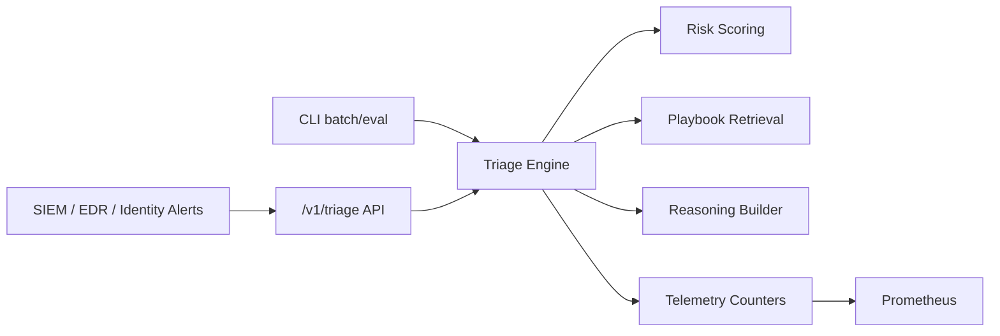

# soc-llm-triage-lab

SOC LLM copilot lab for deterministic incident triage, playbook retrieval, explainable scoring, and operational telemetry.

## Why this anchor matters

This repository demonstrates a practical SOC triage control loop that hiring teams can run locally:

- ingest incident signals
- compute explainable risk score
- retrieve best response playbook
- return analyst-oriented summary with confidence
- expose observability metrics for workload monitoring

## Architecture



See detailed docs in `/docs/ARCHITECTURE.md`.

## Quickstart

### Single incident triage

```bash
PYTHONPATH=src python -m soc_llm_triage.cli triage --incident examples/incident.json
```

### Start API server

```bash
PYTHONPATH=src python -m soc_llm_triage.cli serve --host 0.0.0.0 --port 8082
```

Endpoints:

- `GET /healthz`
- `POST /v1/triage`
- `GET /metrics`

### Docker stack

```bash
make docker-up
```

Services:

- API: `http://localhost:8082`
- Prometheus: `http://localhost:9092`

## Testing

```bash
make test
```

Includes:

- retrieval ranking tests
- scoring + triage tests
- evaluation metrics tests
- HTTP API integration test

## Security

- Security policy: `SECURITY.md`
- Threat model: `docs/THREAT_MODEL.md`

## Roadmap

Roadmap and release scope: `docs/ROADMAP.md`.
