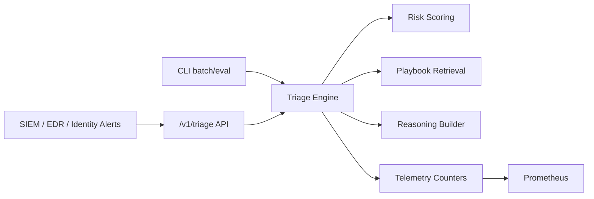

# soc-llm-triage-lab

[](https://github.com/WaiperOK/soc-llm-triage-lab/actions/workflows/ci.yml)
[](https://github.com/WaiperOK/soc-llm-triage-lab/releases)

SOC LLM copilot lab for deterministic incident triage, playbook retrieval, explainable scoring, and operational telemetry.

## Why this anchor matters

This repository demonstrates a practical SOC triage control loop that hiring teams can run locally:

- ingest incident signals
- compute explainable risk score
- retrieve best response playbook
- return analyst-oriented summary with confidence
- expose observability metrics for workload monitoring

## Architecture



See detailed docs in `/docs/ARCHITECTURE.md`.

## Quickstart

### Single incident triage

```bash
PYTHONPATH=src python -m soc_llm_triage.cli triage --incident examples/incident.json
```

### Start API server

```bash
PYTHONPATH=src python -m soc_llm_triage.cli serve --host 0.0.0.0 --port 8082
```

Endpoints:

- `GET /healthz`
- `POST /v1/triage`
- `GET /metrics`

### Docker stack

```bash
make docker-up
```

Services:

- API: `http://localhost:8082`
- Prometheus: `http://localhost:9092`

## Optional LLM summarizer

The triage core is deterministic. You can optionally ask a language model to write a short analyst-facing summary on top of it. The model **only adds prose** in `llm_summary`. Severity, score, confidence and the recommended playbook are always computed by code, and `analyst_summary` stays deterministic.

```bash
# local model through Ollama (incident text stays on your machine)
ollama pull llama3.1:8b
PYTHONPATH=src python -m soc_llm_triage.cli triage --incident examples/incident.json \
  --llm-provider ollama --llm-model llama3.1:8b

# any OpenAI-compatible server (llama.cpp, vLLM, LM Studio, hosted APIs)
SOC_LLM_API_KEY=... PYTHONPATH=src python -m soc_llm_triage.cli serve \
  --llm-provider openai --llm-model <model> --llm-url http://127.0.0.1:8080/v1
```

Settings can also come from `SOC_LLM_PROVIDER`, `SOC_LLM_MODEL`, `SOC_LLM_URL` and `SOC_LLM_API_KEY`. The API key is read from the environment only.

Incident text comes from logs and alerts, so it is attacker-controlled. The summarizer treats it as untrusted data:

| Control | What it does |
|---|---|
| Role separation | Trusted facts (severity, score, playbook) sit outside the data block; incident fields sit inside `<incident_data>` |
| Input sanitizing | Strips invisible and control characters, neutralizes `<` and `>` so the block cannot be closed from inside, truncates fields |
| Output policy | Rejects empty or long output, URLs, markdown, HTML, invisible characters, and any claim of a severity that differs from the computed one |
| Fail closed | Any rejection, timeout or backend error returns the deterministic result with `summary_source=deterministic_fallback` and a `llm_fallback_reason` |
| Observability | `soc_triage_llm_requests_total` and `soc_triage_llm_fallback_total{reason}` in `/metrics`, with no incident text |

`examples/injected_incident.json` contains a log field that tries to close the data block and downgrade the alert. It is used in the test suite.

Remote providers receive incident text. Prefer a local model for sensitive logs.

## Testing

```bash
make test
```

Includes:

- retrieval ranking tests
- scoring + triage tests
- evaluation metrics tests
- HTTP API integration test
- LLM summarizer: output policy, prompt-injection containment, provider stubs, fallback behavior

## Security

- Security policy: `SECURITY.md`
- Threat model: `docs/THREAT_MODEL.md`

## Roadmap

Roadmap and release scope: `docs/ROADMAP.md`.
